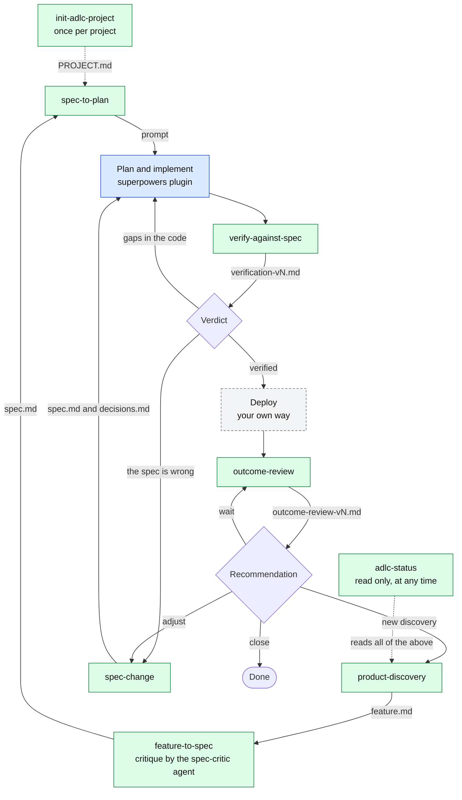

# adlc-toolkit

Skills that assist product development in an ADLC (Agentic Development Lifecycle) way: work flows from discovery of a problem to a feature requirement, a reviewed spec, a plan, an implementation, verification and deployment, with AI agents doing the work and people deciding.

## Install

```
/plugin marketplace add falcovd/falcovd-agentic-marketplace
/plugin install adlc-toolkit@falcovd-agentic-marketplace
```

## ADLC workflow

The toolkit covers the stages marked with a skill. The other stages are open: they have no skill here yet, and some have a recommended plugin.


Green: a skill in this toolkit. Yellow: the toolkit prepares the step and another plugin does it. Blue: recommended plugin, not in this toolkit. Grey: not planned.

| Stage | Skill or tool | Status |
| --- | --- | --- |
| Discovery | `/adlc-toolkit:product-discovery` | Available |
| Feature requirements | `/adlc-toolkit:feature-to-spec` | Available |
| Technical plan | `/adlc-toolkit:spec-to-plan` prepares the prompt for the plan. The plan itself is written by the superpowers plugin (`superpowers:writing-plans`) | Prompt: available. Plan: superpowers |
| Implementing plan | n/a. Recommended: the superpowers plugin (`superpowers:executing-plans` or `superpowers:subagent-driven-development`) | Not in this toolkit |
| Spec change | `/adlc-toolkit:spec-change` (when the spec changes during implementation) | Available |
| Verify and testing | `/adlc-toolkit:verify-against-spec` (traces the acceptance criteria of the spec to evidence). Running tests is up to your project | Available |
| Deploy | n/a | Not planned |
| Outcome review | `/adlc-toolkit:outcome-review` (compares the goals of the feature document with what was measured after release) | Available |

Deploy is not planned, because everyone deploys in a different way. Use the approach that fits your project. `verify-against-spec` does not depend on how you test: it checks that the acceptance criteria of the spec are shown to be met.

Before the first stage, prepare the project once with `/adlc-toolkit:init-adlc-project`. It gives every later stage the project's tech stack, coding standards and architecture.

At any point, run `/adlc-toolkit:adlc-status` to see where each feature stands and what to do next.



`init-adlc-project` gives every later stage the project context. The dotted line shows where it is read most directly. A skill that finds a problem sends the work back: verification to the code or to `spec-change`, and the outcome review to `spec-change` or to a new discovery round.

### Recommended: superpowers plugin

The technical plan and implementing plan stages work well with the superpowers plugin. Install it separately:

```
/plugin marketplace add obra/superpowers-marketplace
/plugin install superpowers@superpowers-marketplace
```

Then run `/adlc-toolkit:spec-to-plan` to get the prompt for the plan, and paste that prompt into Claude. It asks Claude to use the `superpowers:writing-plans` skill. Use `superpowers:executing-plans` or `superpowers:subagent-driven-development` to implement the plan.

## Language

Every file a skill writes is in English, whatever language you use. This covers `discovery/`, the spec files and `.adlc-project/`. The skills may talk to you in your own language, but never write files in it. One language keeps the output consistent from discovery to spec, so each stage can read the one before it.

## Document contract

`product-discovery` and `feature-to-spec` hand work over through `feature.md`. Its format is defined once in [`contracts/feature-document.md`](contracts/feature-document.md). Both skills follow it, so the chain from discovery to spec keeps working when a skill changes. To change the format, edit the contract first, then both skills, then run `tests/check-feature-contract.sh`.

`feature-to-spec` writes `spec.md`. Skills that come after it read its IDs (`US-n`, `FR-n`, `NFR-n`, `AC-n.m`), so its format is defined once in [`contracts/spec-document.md`](contracts/spec-document.md). To change it, edit the contract first, then the skill, then run `tests/check-spec-contract.sh`. The same contract defines the optional `## Change History` section and the change record that `spec-change` writes; they are checked by `tests/check-spec-change.sh`.

`verify-against-spec` writes `verification-vN.md`. Its format is defined once in [`contracts/verification-document.md`](contracts/verification-document.md). To change it, edit the contract first, then the skill, then run `tests/check-verification-contract.sh`.

`outcome-review` reads the goals of `feature.md` and writes `outcome-review-vN.md`. Its format is defined once in [`contracts/outcome-document.md`](contracts/outcome-document.md). To change it, edit the contract first, then the skill, then run `tests/check-outcome-contract.sh`.

## Skills

### `product-discovery`

Run: `/adlc-toolkit:product-discovery`

The discovery track, the step before `feature-to-spec`. Takes a vague problem to a validated feature document.

- Frames the problem and writes a problem statement with falsification criteria set in advance.
- Lets you set the confidence thresholds at the start of a run: how many persona-matching interviews count as high confidence (default 5) and how many source types must agree (default 2).
- Gathers data evidence from connected sources, then pauses so you can interview real users.
- Re-invoke it after the interviews: it judges all evidence against the criteria and, if the problem holds up, writes `feature.md`.
- Output goes to `discovery/<topic>/`. `feature.md` is the input for `feature-to-spec`.

### `init-adlc-project`

Run: `/adlc-toolkit:init-adlc-project`

Captures a project's technical context in `.adlc-project/PROJECT.md` and adds a marked block to the root `AGENTS.md`. The block points agents to the files in `.adlc-project/` so they load them when a session begins. Claude Code reads `CLAUDE.md`, not `AGENTS.md`, so the skill also offers to add the line `@AGENTS.md` to `CLAUDE.md`.

- Covers Tech Stack, Coding Standards and System Architecture. UX Guide and API Conventions are optional.
- Detects what it can from the code, confirms it with you, and asks for everything else. It never assumes.
- Notes the source of each fact. You can answer "TBD" and fill it in on a later run.
- Works on existing projects, new projects and repositories with several packages.
- Asks before adding `@AGENTS.md` to `CLAUDE.md`, because Claude Code reads `CLAUDE.md` and not `AGENTS.md`.
- Writes nothing until you approve the result. Never writes secrets or personal data. Never commits: review and commit the files yourself.
- Re-running it is the way to update the context.

### `feature-to-spec`

Run: `/adlc-toolkit:feature-to-spec`

Guides a product owner from a feature idea or document to an approved PRD and a spec (what and why, no technical solution).

- Critique rounds by the `spec-critic` agent (a read-only reviewer with a clean context), and explicit approval at each phase.
- Open product questions are asked, not parked in the document.
- Output: `feature.md`, `prd.md`, `spec.md` and `decisions.md`, all in English.

The critique rounds are run by the `spec-critic` agent (`agents/spec-critic.md`): a read-only reviewer with a clean context, with one checklist for the feature document, the PRD and the spec.

The spec is the input for the technical plan.

### `spec-to-plan`

Run: `/adlc-toolkit:spec-to-plan`

Prepares the step from the spec to the technical plan. It gives you a ready-to-copy prompt for Claude, to continue with `superpowers:writing-plans`. It writes no plan and no file.

- The prompt points to `spec.md` and, if it exists, `.adlc-project/PROJECT.md`, and summarises the project constraints. Without a project context file it tells the planner to inspect the codebase, so `init-adlc-project` is not required.
- It lists the IDs of the spec and the technical questions the spec left for the plan, and asks that every plan task names the IDs it delivers and that the plan ends with a coverage table.
- The prompt is self-contained, so another developer can use it in their own session. The skill warns when `spec.md` is not committed yet.

### `spec-change`

Run: `/adlc-toolkit:spec-change`

Handles a change to an approved spec while the feature is being built, so the plan and the verification do not drift away from it.

- Proposes the change set (added, changed and retired user stories, requirements and acceptance criteria) and checks it against the spec contract.
- A change of an acceptance criterion's behaviour retires its ID and adds a new one, so old evidence never counts for new behaviour. IDs are never reused.
- Finds the next free ID and lints the edited spec with `scripts/spec-rules.sh` when Bash is available.
- Reports the impact on plan files, tests and the latest verification report, read only.
- Writes nothing until the product owner approves. Then it updates `spec.md` with a Change History entry and records the decision in `decisions.md`.
- Never edits plans, tests, code or reports, and never commits.

### `verify-against-spec`

Run: `/adlc-toolkit:verify-against-spec`

Checks an implemented project against its `spec.md` and reports, per acceptance criterion, whether it is covered, uncovered, deviating or not verifiable, with `file:line` evidence.

- Finds evidence by the acceptance criterion ID first. If there is none, it matches by meaning and asks you to confirm the link. An unconfirmed link never counts as covered.
- Reads only by default. It asks once whether to run the project's tests, and runs nothing without your yes.
- Gives a verdict per user story and an overall verdict, with the limits of what could not be checked.
- Output: `verification-v1.md`, `verification-v2.md`, ... next to `spec.md`. A re-run keeps the earlier versions and re-checks only open criteria.
- Never edits code, tests or the spec, and never commits.

### `outcome-review`

Run: `/adlc-toolkit:outcome-review`

Closes the loop after release. Compares the goals of `feature.md` (metric, baseline, target, timeframe) with what was measured, and reports per goal whether the target was met, partially met, missed, not measurable or too early.

- You supply the measured values, or a file with the data. If data sources are connected, it offers to pull a value, shows the query and sample, and pulls nothing without your yes.
- Gives an overall verdict and a recommendation: close, adjust, new discovery or wait. You decide.
- Says what the data cannot show. A met target does not prove the feature caused it.
- Output: `outcome-review-v1.md`, `outcome-review-v2.md`, ... next to `feature.md`. For a new discovery round, the report has a section with findings you can cite in `product-discovery`.
- Never edits `feature.md` or any other file, and never commits.

### `adlc-status`

Run: `/adlc-toolkit:adlc-status`

Shows where each feature stands in the chain, so that you know what to do next. It only reads: it writes no file.

- Lists discovery topics and spec folders, and shows a topic and a spec folder with the same name as one row.
- Per item: the stage, the last approved step, what is waiting for a person and the next skill to run.
- Discovery topics use the same state detection as `product-discovery`. For specs it reads the spec version, the latest verification report (and whether a spec change came after it) and the latest outcome review. A plan counts as found only when a plan file names the spec path, and is shown as inferred.
- Implementation and deployment are shown as not tracked by the toolkit.

## Agents

### `spec-critic`

A read-only reviewer (tools: `Read`, `Grep`, `Glob`) that `feature-to-spec` starts for every critique round. It has a clean context: it sees the files, not the conversation that produced them. It has one checklist per mode (`feature`, `prd`, `spec`) and returns findings classed Must, Should or Could. It is defined in [`agents/spec-critic.md`](agents/spec-critic.md).

## Plugin layout

```
.claude-plugin/plugin.json   manifest
skills/<skill>/SKILL.md      the skills (some with templates/)
agents/                      agents that skills hand work to
contracts/                   formats shared between skills
scripts/                     scripts that skills run or mirror
tests/                       check-*.sh, fixtures/ and SCENARIOS.md
CHANGELOG.md                 version history
```

Skills read the contracts and call the scripts through `${CLAUDE_PLUGIN_ROOT}`.

## Scripts

The scripts in [`scripts/`](scripts/) are the executable form of rules that a skill also describes in words: `discovery-state.sh`, `adlc-status.sh`, `spec-rules.sh`, `plan-prompt.sh`, `verification-status.sh` and `outcome-status.sh`. `spec-change` runs `spec-rules.sh` itself. The others are used by the checks, so that a change to a skill and its script stays in step.

## Development

Static checks run in CI and locally. Run all of them:

```bash
for t in plugins/adlc-toolkit/tests/check-*.sh; do bash "$t"; done
```

There is one check per contract or skill, for example `check-spec-contract.sh`, `check-spec-change.sh` and `check-spec-critic.sh`. Manual scenarios for the interactive behaviour of the skills are in `plugins/adlc-toolkit/tests/SCENARIOS.md`.

## License

[MIT](../../LICENSE).

## Changes

See [CHANGELOG.md](CHANGELOG.md). Versions follow [Semantic Versioning](../../VERSIONING.md).
